# PStreamBench Workloads (Real-World and Synthetic)

PStreamBench includes **14 real-world streaming workloads** and **9 synthetic query shapes** (see [Synthetic Queries](#synthetic-queries)). The real-world suite has 14 workloads inspired by established DSPS/database benchmarks and prior studies (e.g., **Linear Road**, **Smart Grid**, **Ads Analytics**, **Click Analytics**). The suite is designed to cover major performance indicators such as **CPU**, **network**, and **memory/state** behavior that react differently to changes in **Degree of Parallelism (DoP)**.

This diversity is important for evaluating **scaling efficiency**, because changing DoP can shift bottlenecks between CPU saturation, network bandwidth, and state/data redistribution overheads.

Based on operator semantics and communication patterns, we assign each workload a primary bottleneck class:

1. **CPU-bound pipelines** (compute saturation and thread contention)  
2. **Memory-bound / stateful workloads** (state access, memory pressure, coordination)  
3. **Network-bound / shuffle- / join-intensive pipelines** (repartitioning fan-out and exchange overhead)  
4. **Lightweight stateless / group-by pipelines** (coordination overhead and saturation)  
5. **Mixed operator / UDF-rich DAGs** (compound bottlenecks and bottleneck shifts)

---

## Workload Taxonomy

## 1) Lightweight Stateless / Group-by Pipelines

### Word Count (WC)
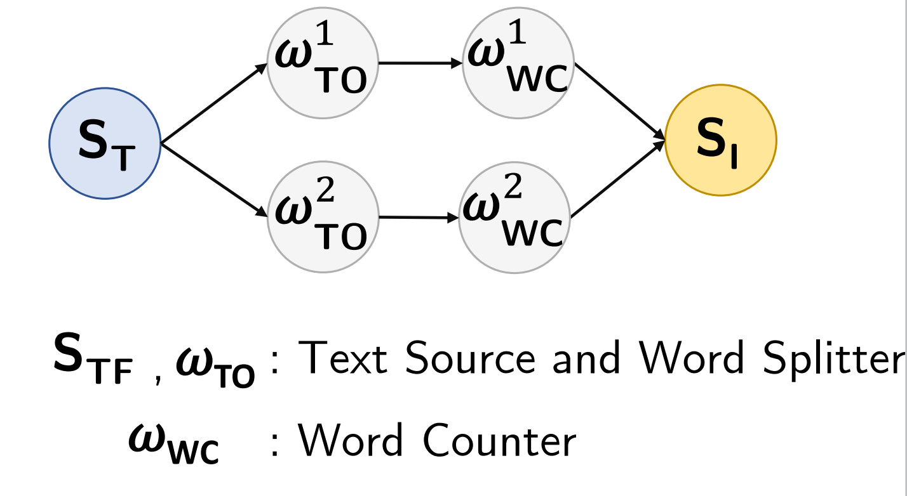

**Area:** Text Processing  
Processes a text stream, tokenizes sentences into words, and counts occurrences of each word in real-time using a keyed aggregation.  
**Why this class:** lightweight per-tuple processing with group-by aggregation; performance is sensitive to coordination and key distribution.

---

## 2) CPU-Bound Pipelines

### Machine Outlier (MO)
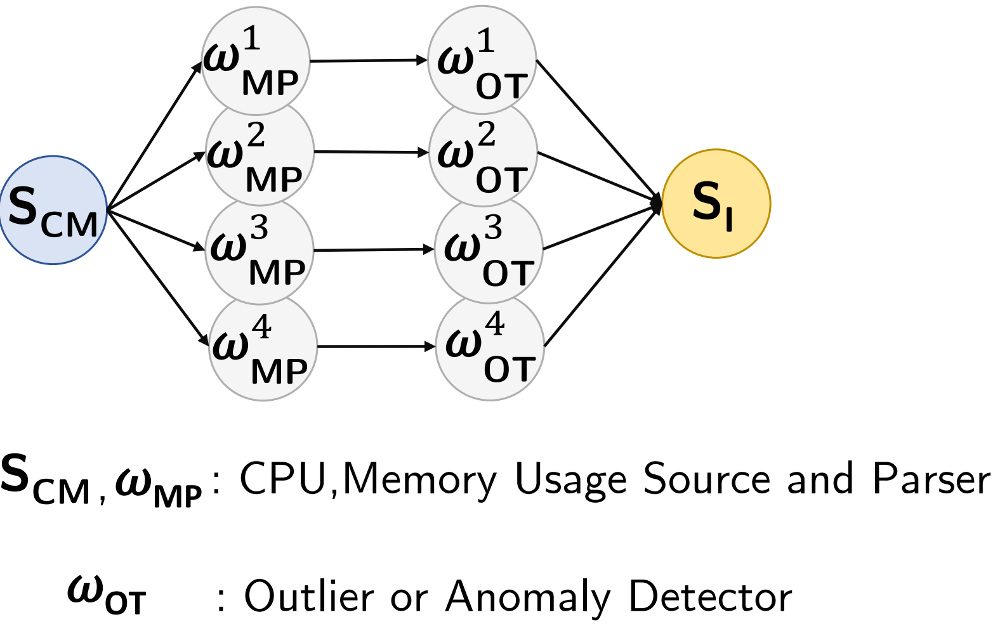

**Area:** Network Monitoring  
Detects anomalies in machine usage data by processing a usage stream using a median-based selection approach (e.g., BFPRT-style logic).  
**Why this class:** dominated by computation per tuple/window; scaling is driven by CPU saturation and UDF cost.

---

## 3) Memory-Bound / Stateful Workloads

### Spike Detection (SD)
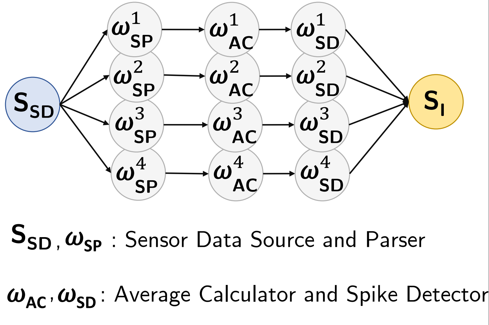

**Area:** Sensor Network  
Processes sensor data streams to detect sudden temperature spikes by computing sliding-window averages and identifying deviations beyond a threshold.  
**Why this class:** windowed aggregation maintains state; state access, memory pressure, and coordination dominate at scale.

### Trending Topics (TT)
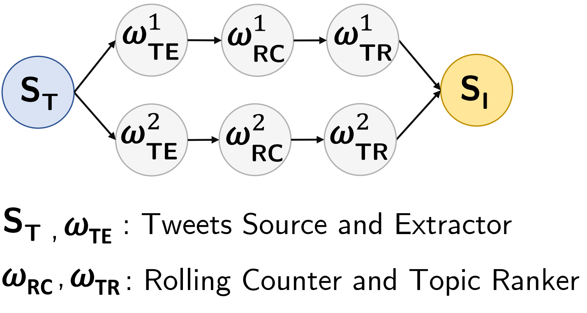

**Area:** Social Network  
Processes tweet streams to identify trending topics using parsing and aggregated popularity counts over windows with ranking/thresholding.  
**Why this class:** windowed counts and ranking maintain state; memory/state pressure grows with cardinality and window size.

### Smart Grid (SG)


**Area:** Sensor Network  
Analyzes smart-home energy usage through two queries that compute global and local loads using sliding windows.  
**Why this class:** stateful/windowed aggregations accumulate state; memory pressure and coordination costs are primary factors.

---

## 4) Network-Bound / Shuffle- / Join-Intensive Pipelines

### Ad Analytics (AD)
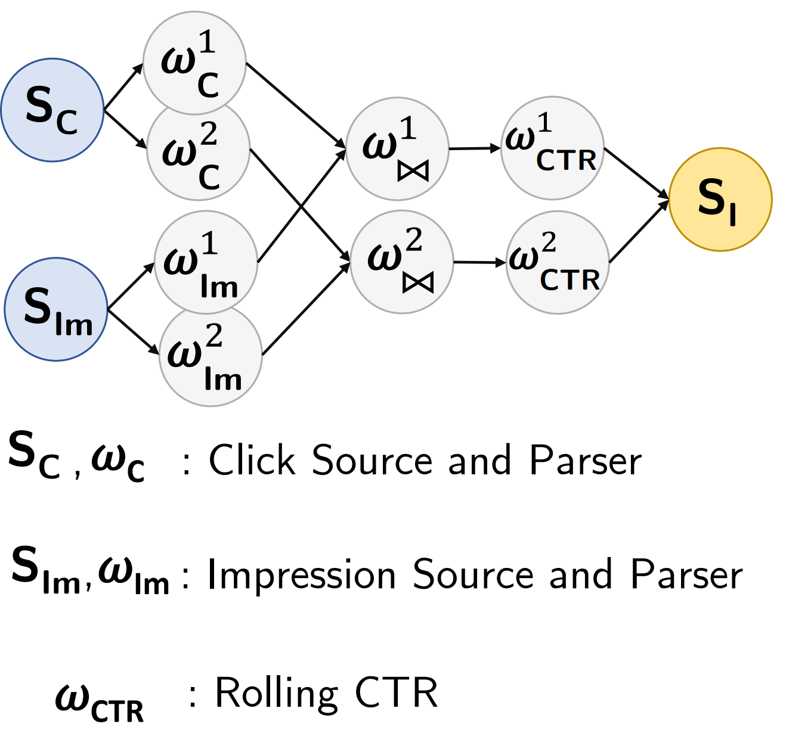

**Area:** Advertising  
Processes click and impression streams in separate pipelines and computes windowed click-through rate (CTR).  
**Why this class:** shuffle/exchange overhead is dominant due to repartitioning and combining streams at scale.

### Bargain Index (BI)
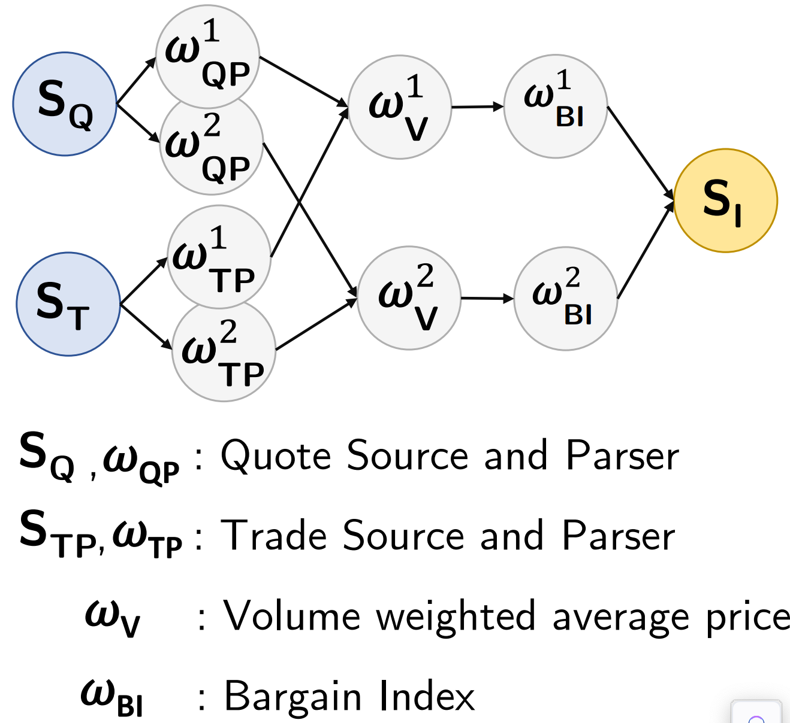

**Area:** Finance  
Analyzes stock quote streams to identify bargains by computing VWAP-like measures and a bargain index, emitting quotes that exceed a threshold.  
**Why this class:** high exchange volume with windowed computations; repartitioning and network overhead dominate under scale.

### TPC-H (TPCH)
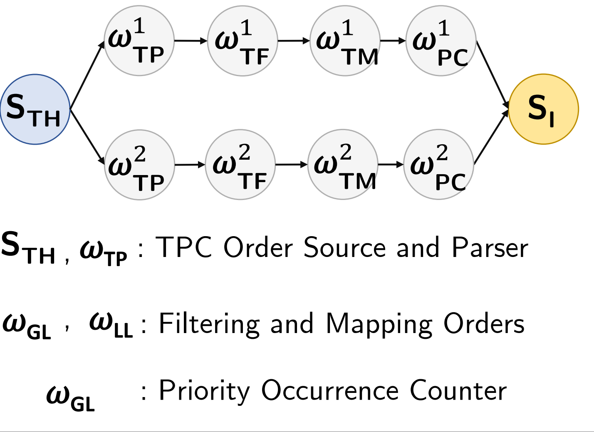

**Area:** E-commerce  
Processes order events to emit high-priority orders and aggregates order priority occurrences within time windows.  
**Why this class:** grouping/aggregation at scale can stress repartitioning and network exchange paths.

---

## 5) Mixed Operator / UDF-Rich DAGs

### Linear Road (LR)
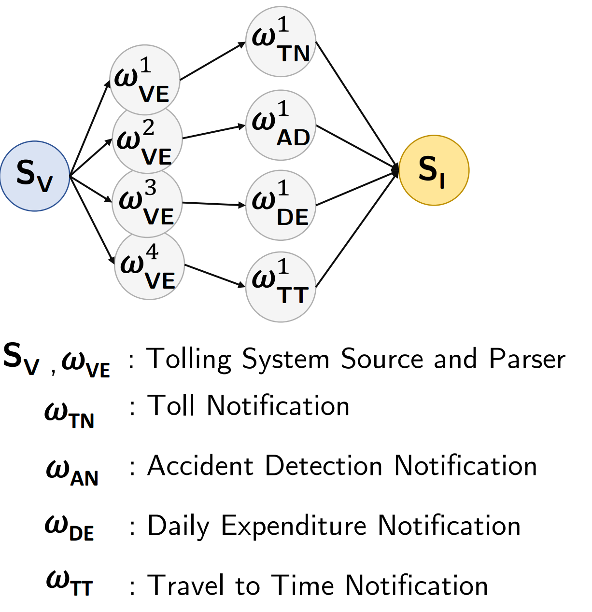

**Area:** Traffic Management  
Processes vehicle location streams through four queries (toll notification, accident notification, daily expenditure, total travel time) to calculate charges and detect incidents.  
**Why this class:** multi-stage pipeline with state and repartitioning; bottlenecks can shift between CPU, state coordination, and network.

### Logs Processing (LP)
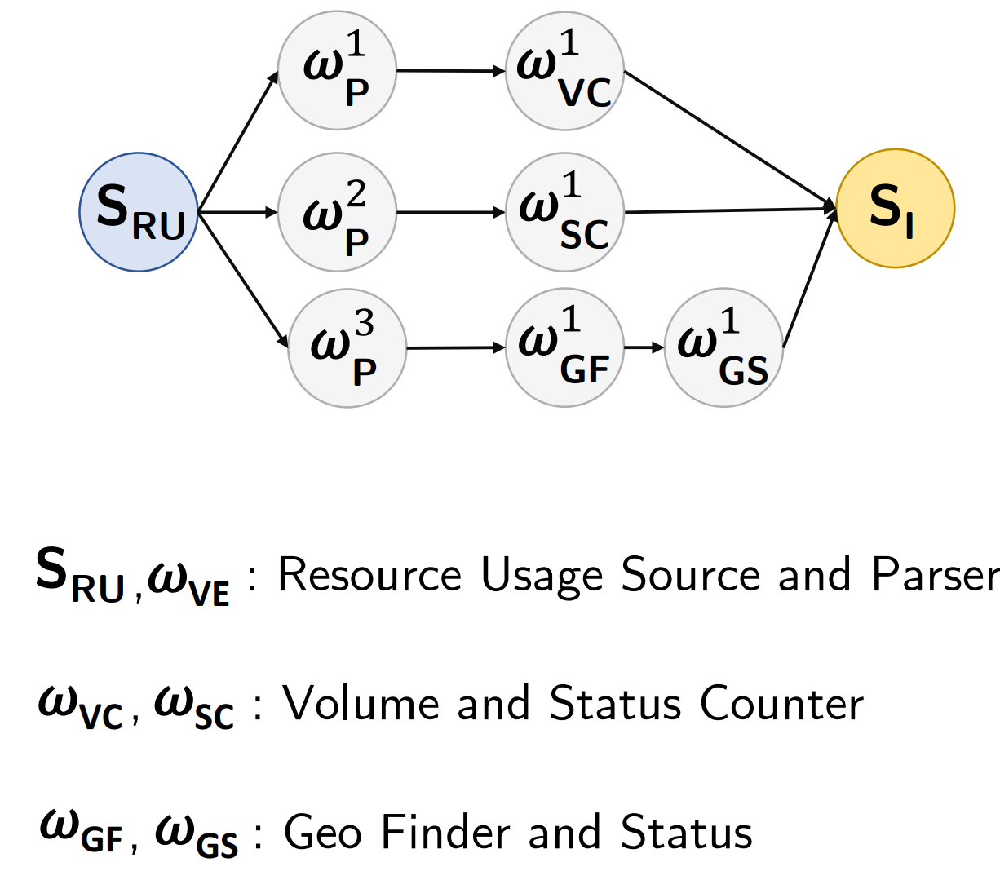

**Area:** Web Analytics  
Processes HTTP server logs using two main queries: one counts visits per interval (volume counter), and another tallies status codes.  
**Why this class:** parsing + aggregation mix; bottleneck can shift between CPU parsing and coordination/state overhead.

### Google Cloud Monitoring (GCM)
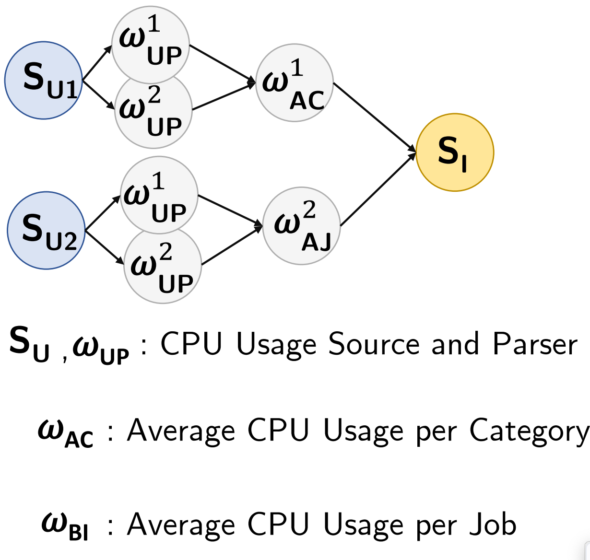

**Area:** Cloud Infrastructure  
Computes average CPU usage over time, grouped by job or category, using sliding windows and grouping operators.  
**Why this class:** grouping + windowing + parsing leads to mixed behavior; bottleneck depends on cardinality and state pressure.

### Sentiment Analysis (SA)
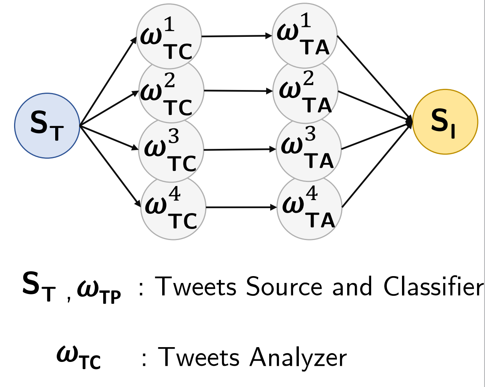

**Area:** Social Network  
Determines tweet sentiment using parsing and classification operators (e.g., Basic/LingPipe classifiers) to score and label tweets.  
**Why this class:** UDF-heavy classification plus pipeline logic; bottlenecks can shift with DoP and input rate.

### Click Analytics (CA)
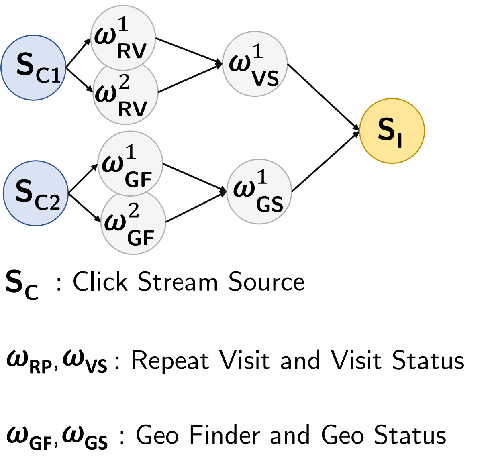

**Area:** Web Analytics  
Analyzes user clicks via two queries: (1) groups clicks by client to compute repeat/total visits per URL, (2) identifies geographic origins using a Geo-IP database.  
**Why this class:** enrichment + aggregation + state; compound bottlenecks and bottleneck shifts are common.

### Traffic Monitoring (TM)
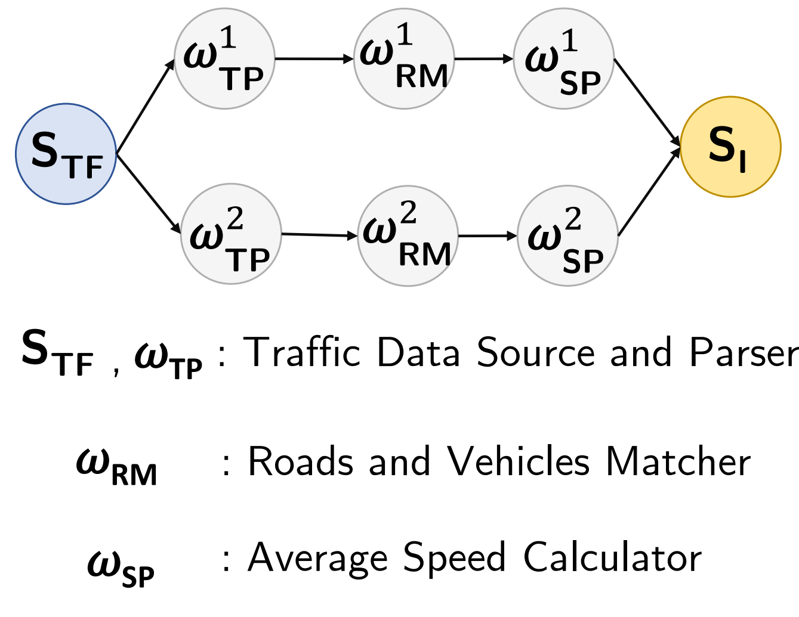

**Area:** Sensor Network  
Matches vehicle locations to road segments (map matching) and computes average speed per segment via aggregation.  
**Why this class:** compute-heavy matching plus stateful aggregation; bottleneck can shift between CPU and state/coordination.

---

## Summary Table

<table>
  <thead>
    <tr>
      <th>Workload</th>
      <th>CPU</th>
      <th>State</th>
      <th>Network</th>
      <th>UDF</th>
      <th>Stateless</th>
      <th>ML</th>
      <th>Why this category?</th>
      <th>Data flow graph (query plan)</th>
    </tr>
  </thead>
  <tbody>
    <tr>
      <td><b>AD</b> (Ads Analytics)</td>
      <td></td><td>✓</td><td>✓</td><td></td><td></td><td></td>
      <td>Two-branch pipeline that aggregates clicks and impressions, then performs a windowed join; join state and repartitioning dominate.</td>
      <td><code>Source</code> &rarr; <code>ParseClicks</code> || <code>ParseImpressions</code> &rarr; <code>keyBy(qid,adid)</code> &rarr; <code>Agg(sum)</code> || <code>Agg(sum)</code> &rarr; <code>WindowJoin</code> &rarr; <code>Filter/CTR</code> &rarr; <code>Sink</code></td>
    </tr>
     <tr>
      <td><b>BI</b> (Bargain Index)</td>
      <td></td><td>✓</td><td></td><td>✓</td><td></td><td></td>
      <td>Keyed sliding window maintains VWAP state/timers; downstream index computation is secondary.</td>
      <td><code>Source</code> &rarr; <code>ParseQuote(map)</code> &rarr; <code>keyBy(sym)</code> &rarr; <code>WinAgg(VWAP)</code> &rarr; <code>ComputeBI(flatMap)</code> &rarr; <code>Sink</code></td>
    </tr>
    <tr>
      <td><b>CA</b> (Click Analytics)</td>
      <td></td><td>✓</td><td></td><td>✓ (Q2)</td><td></td><td></td>
      <td>Repeat-visit keeps keyed window state and adds a second keyed reduce; geo variant adds enrichment UDFs.</td>
      <td>
        <code>Source</code> &rarr; <code>ParseClick(map)</code> &rarr;
        <br/>
        <small>
          (Q1/Q3: <code>keyBy(client)</code> &rarr; <code>WinAgg(RV)</code> &rarr; <code>keyBy(url)</code> &rarr; <code>Reduce</code>)
          &nbsp;||&nbsp;
          (Q2: <code>GeoEnrich(Process/UDF)</code>)
        </small>
        <br/>
        &rarr; <code>Sink</code>
      </td>
    </tr>
    <tr>
      <td><b>GCM</b> (Google Cloud Monitoring)</td>
      <td></td><td>✓</td><td></td><td>✓</td><td></td><td></td>
      <td>Keyed sliding windows per category/job maintain state and trigger timers; window coordination dominates.</td>
      <td><code>Source</code> &rarr; <code>ParseTaskEvt(map)</code> &rarr; <code>keyBy(cat/job)</code> &rarr; <code>WinAgg(Apply/Process)</code> &rarr; <code>Sink</code></td>
    </tr>
    <tr>
      <td><b>LR</b> (Linear Road)</td>
      <td></td><td>✓</td><td></td><td></td><td></td><td></td>
      <td>All variants are key-driven and/or windowed, requiring per-key tracking and window coordination.</td>
      <td>
        <code>Source</code> &rarr; <code>ParseVehicle(map)</code> &rarr;
        <small>
          (Q1: <code>keyBy(veh)</code> &rarr; <code>map</code>) |
          (Q2: <code>keyBy(time)</code> &rarr; <code>WindowProcess</code>) |
          (Q3/Q4: <code>keyBy(veh)</code> &rarr; <code>map</code>)
        </small>
        &rarr; <code>Sink</code>
      </td>
    </tr>
    <tr>
      <td><b>LA</b> (Log Processing)</td>
      <td></td><td>✓</td><td></td><td>✓</td><td></td><td></td>
      <td>Keyed sliding-window counters maintain per-window state and timers for volume/status metrics.</td>
      <td><code>Source</code> &rarr; <code>ParseLog(map)</code> &rarr; <code>keyBy(logTime)</code> &rarr; <code>WinAgg(Volume/Status)</code> &rarr; <code>Sink</code></td>
    </tr>
    <tr>
      <td><b>MO</b> (Machine Outlier)</td>
      <td>✓</td><td>✓</td><td></td><td>✓</td><td></td><td></td>
      <td>Keyed sliding window maintains state while the window function runs compute-heavy outlier selection.</td>
      <td><code>Source</code> &rarr; <code>ParseMachineUsage(map)</code> &rarr; <code>keyBy(machine)</code> &rarr; <code>WinAgg(Outlier/BFPRT)</code> &rarr; <code>Sink</code></td>
    </tr>
    <tr>
      <td><b>SA</b> (Sentiment Analysis)</td>
      <td>✓</td><td></td><td></td><td>✓</td><td></td><td>✓</td>
      <td>Text preprocessing and sentiment classification are compute-heavy and ML-based; CPU/UDF dominate.</td>
      <td><code>ParseJSON</code> &rarr; <code>Filter(lang)</code> &rarr; <code>Preproc</code> &rarr; <code>Classify(ML)</code> &rarr; <code>Sink</code></td>
    </tr>
    <tr>
      <td><b>SG</b> (Smart Grid)</td>
      <td></td><td>✓</td><td></td><td>✓</td><td></td><td></td>
      <td>Keyed sliding windows maintain per-house state and timers; repartitioning increases coordination at higher DoP.</td>
      <td><code>Source</code> &rarr; <code>ParseHouseEvt(map)</code> &rarr; <code>keyBy(house / house,hh,plug)</code> &rarr; <code>WinAgg(Q1/Q2)</code> &rarr; <code>Sink</code></td>
    </tr>
    <tr>
      <td><b>SD</b> (Spike Detection)</td>
      <td></td><td>✓</td><td></td><td>✓</td><td></td><td></td>
      <td>Keyed moving-average window maintains state; downstream spike filter is lightweight.</td>
      <td><code>Source</code> &rarr; <code>ParseSensor(flatMap)</code> &rarr; <code>keyBy(sensor)</code> &rarr; <code>WinAgg(MovAvg)</code> &rarr; <code>Filter(spike)</code> &rarr; <code>Sink</code></td>
    </tr>
    <tr>
      <td><b>TPCH</b> (TPC-H Stream Query)</td>
      <td></td><td>✓ (Q2)</td><td></td><td>✓</td><td>✓ (Q1)</td><td></td>
      <td>Q1 is lightweight filter/mapping; Q2 adds a keyed sliding window; both end in keyed priority aggregation.</td>
      <td>
        <code>Source</code> &rarr; <code>ParseTPCH(map)</code> &rarr;
        <small>(Q1: <code>Filter</code>) | (Q2: <code>keyBy(discount)</code> &rarr; <code>WinAgg</code>)</small>
        &rarr; <code>MapPriority(flatMap)</code> &rarr; <code>keyBy(priority)</code> &rarr; <code>Agg(sum)</code> &rarr; <code>Sink</code>
      </td>
    </tr>
    <tr>
      <td><b>TM</b> (Traffic Monitoring)</td>
      <td>✓</td><td>✓</td><td></td><td>✓</td><td></td><td></td>
      <td>Map matching is a compute-heavy UDF, followed by a keyed sliding-window aggregation per road.</td>
      <td><code>Source</code> &rarr; <code>ParseTraffic(map)</code> &rarr; <code>MapMatch(UDF)</code> &rarr; <code>keyBy(road)</code> &rarr; <code>WinAgg(AvgSpeed)</code> &rarr; <code>Sink</code></td>
    </tr>
    <tr>
      <td><b>TT</b> (Trending Topics)</td>
      <td>✓</td><td>✓</td><td></td><td>✓</td><td></td><td></td>
      <td>Topic extraction is compute-heavy; then keyed sliding-window counting maintains state/timers before thresholding.</td>
      <td><code>Source</code> &rarr; <code>ParseTweet(map)</code> &rarr; <code>ExtractTopic(UDF)</code> &rarr; <code>keyBy(topic)</code> &rarr; <code>WinAgg(Count)</code> &rarr; <code>Filter(thresh)</code> &rarr; <code>Sink</code></td>
    </tr>
    <tr>
      <td><b>WC</b> (WordCount)</td>
      <td></td><td></td><td></td><td></td><td>✓</td><td></td>
      <td>Simple split-and-count; keyed aggregation; lightweight per-record work and minimal state.</td>
      <td><code>Source</code> &rarr; <code>Split(flatMap)</code> &rarr; <code>keyBy(word)</code> &rarr; <code>Agg(sum)</code> &rarr; <code>Sink</code></td>
    </tr>
  </tbody>
</table>


## Notes on Interpretation

- This classification reflects the **dominant** bottleneck under typical configurations. Under different rates, key cardinalities, and DoP settings, workloads may **shift** bottlenecks.
- The taxonomy is intended to guide scaling studies, heterogeneous resource selection, and comparisons across all five supported engines (Flink, Storm, Spark, Kafka Streams, RisingWave) — see the `flink/`, `storm/`, `spark/`, `kafkastreams/`, and `risingwave/` subfolders for each engine's job implementations.

---

## Synthetic Queries

The synthetic queries complement the real-world workloads. Each one is a **fixed operator graph** that isolates one
structural dimension of a query (pipeline depth, filter chains, join width), so that the effect of parallelism can be
studied without the data characteristics of a specific application. Every run of a shape has the same graph; only the
parallelism and the input rate change.

### Data model

- Each record is `(key, value)`: `key` is drawn uniformly from a key space `[0, K)`, `value` is uniform in `[0, 1)`.
- No event-time field. Windows are **1-second tumbling windows on processing time** (RisingWave: the Kafka
  produce timestamp with a 1-second watermark, its closest equivalent).
- Window size, thresholds and key space are fixed per shape; only parallelism and event rate are swept.

### The nine shapes

| Shape | Folder name | Operator graph | Stages with their own DoP |
|---|---|---|---|
| Linear | `LinearQuery` | source → filter1 (value < 0.5) → windowed avg per key → filter2 → sink | filter1, window-agg, filter2 |
| 2 / 3 / 4 chained filters | `TwoFilters`, `ThreeFilters`, `FourFilters` | source → windowed avg per key → filter × N → sink | window-agg, filter1..N |
| 2-way / 3-way join | `TwoWayJoin`, `ThreeWayJoin` | N sources, each pre-filtered (value < 0.5) → N−1 pairwise windowed joins on `key` → windowed avg → sink | pre-filters, join(s), window-agg |
| 4 / 5 / 6-way join | `FourWayJoin`, `FiveWayJoin`, `SixWayJoin` | N sources, no pre-filter → N−1 pairwise windowed joins on `key` → windowed avg → sink | join(s), window-agg |

- **Filter thresholds** of the chained-filter shapes are 0.52, 0.50, 0.48, 0.46 (filter1..4), chosen so that each filter
  removes part of the window averages (which cluster around 0.5). Measured selectivities for 4 filters: about
  0.77 → 0.65 → 0.47 → 0.34.
- **Join key space.** With a fixed key space, join output either explodes (narrow joins) or vanishes (wide joins).
  `K` is therefore calibrated per shape so that every join width produces about `target` matches per window
  (default 1000):

  ```
  K = (n_w^N / target)^(1/(N-1))
  ```

  where `n_w` is the per-source tuple count per window after pre-filtering (event rate × pre-filter selectivity ×
  window length) and `N` the join width. `--keySpace` overrides it, `--targetMatches` changes the target.
- **Join operators per engine.** Storm's `JoinBolt` fuses all N−1 joins into one bolt (one join DoP per shape); Flink,
  Spark and Kafka Streams expose each pairwise join as its own operator.

### Engine implementations

Each engine has its own project next to the real-world jobs; the real-world projects are not modified.

| Engine | Project | Input | Output |
|---|---|---|---|
| Flink | `flink/dsp_flink_synthetic_jobs` | in-process `DataGeneratorSource` (no Kafka) | `DiscardingSink` |
| Storm | `storm/dsp_storm_synthetic_jobs` | in-process `SyntheticSpout` (no Kafka) | `KafkaBolt` on the cluster, file sink in local mode |
| Spark Structured Streaming | `spark/dsp_spark_synthetic_jobs` | `rate` source (in-process) | `noop` sink |
| Kafka Streams | `kafkastreams/dsp_kafkastreams_synthetic_jobs` | Kafka topic, filled by `SyntheticProducer.java` | Kafka topic |
| RisingWave | `risingwave/dsp_risingwave_synthetic_jobs/<Shape>/*.sql` | Kafka source (same `SyntheticProducer.java`) | Kafka sink |

The parallelism argument is a vector `[source, interior stages..., sink]` in the stage order of the table above.
Kafka Streams and RisingWave apply one job-level parallelism to the whole query.

### Benchmark settings used in the paper

- Event rates 100k, 500k and 1M events/s; uniform DoP 2, 4, 8, 16, 32, 40 for all interior stages;
  fixed source and sink DoP (Storm sweep: source 2, sink 1); 5 minutes per run.
- Strategies: `uniform`, `random` (Storm sweep: 10 samples per shape and rate, seed 42), `ds2` and `dhalion`
  (one decision computed from the uniform DoP-2 run).
- Metrics are collected by the same `getprom_*.py` collectors as the real-world workloads, so synthetic and
  real-world runs share one result schema (`evaluationMetrics-*.json`, `metaInfo-*.json`).

### Known differences between engines

- **RisingWave `LinearQuery`** has no filters (source → windowed avg → sink), unlike the other four engines.
- **Linear filter2 threshold**: Flink and Storm use `avg < 0.25`, Spark and Kafka Streams use `avg < 0.5`.
- In-process sources (Flink, Storm, Spark) do not pay the Kafka read cost that Kafka Streams and RisingWave pay.

Design rationale, validation runs and the bugs found while building the shapes are documented in
[`SYNTHETIC_WORKLOAD_CONTRIBUTIONS.md`](../SYNTHETIC_WORKLOAD_CONTRIBUTIONS.md).

