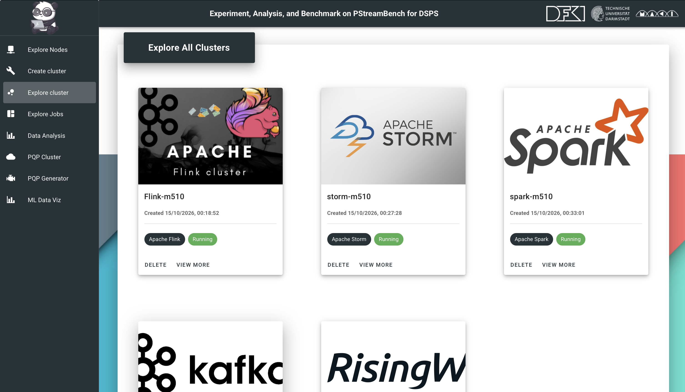

<h1>PStreamBench – Web User Interface (WUI) (Flink, Storm, Spark, Kafka Streams & RisingWave)</h1>

In the context of distributed stream processing (DSP) benchmarking, the PStreamBench Web User Interface (WUI)
simplifies benchmark configuration, execution, and monitoring for <b>Apache Flink</b>, <b>Apache Storm</b>,
<b>Apache Spark</b>, <b>Kafka Streams</b>, and <b>RisingWave</b>.

<ul>
  <li>
    Acts as a portal to deploy homogeneous/heterogeneous clusters, configure DSP settings, select workloads,
    and choose parallel query plans (real-world and synthetic benchmarks) for any of the five supported engines.
  </li>
  <li>
    Forwards the user-defined benchmark configuration to the
    <a href="https://github.com/anonymoususer3887/PStreamBench/blob/main/PStreamBench_controller/README.md">PStreamBench_controller</a>,
    which orchestrates cluster setup and job execution on the selected DSPS.
  </li>
  <li>
    Provides real-time visualization of key performance indicators (e.g., throughput, end-to-end latency,
    and resource utilization) during job execution.
  </li>
  <li>
    Stores configurations and measured performance metrics (via the controller’s database) to support
    historical analysis and comparisons across systems and hardware.
  </li>
</ul>

  

<h2>Getting Started with the WUI</h2>

<ol>
  <li><a href="#prerequisite">Prerequisites</a></li>
  <li><a href="#general">General setup</a>
    <ul>
      <li><a href="#local">Local environment</a></li>
      <li><a href="#remote">Remote environment</a></li>
    </ul>
  </li>
  <li><a href="#setupCluster">Setup cluster (e.g., CloudLab)</a></li>
  <li>
    Previous step: setup and start the controller
    (<a href="https://github.com/anonymoususer3887/PStreamBench/blob/main/PStreamBench_controller/README.md">PStreamBench_controller README</a>)
  </li>
</ol>

<h2 id="prerequisite">Prerequisites</h2>
<ul>
  <li>Ubuntu 20.04 (or equivalent Linux). Windows 10/11 via WSL is also supported.</li>
  <li>Docker (optional) to install/manage dependencies.</li>
  <li>WUI is implemented in <a href="https://vuejs.org/">Vue.js</a>.</li>
  <li>Node.js (v16+) and npm (v9+ recommended).</li>
</ul>

<h2 id="general">General Steps for Setting up the WUI</h2>

The WUI can be run locally or on a remote machine. The controller can deploy and manage Flink, Storm, Spark, Kafka Streams, or RisingWave clusters.

<h3 id="local">First-time setup (local)</h3>
<pre><code>cd ~/PStreamBench/dsp_fe/
npm install
npm run serve
</code></pre>

Open the URL printed in the terminal (commonly <code>http://localhost:8080</code>).

<h3 id="remote">First-time setup (remote)</h3>
<pre><code>cd ~/PStreamBench/dsp_fe/
ls -al
vim .env.development.local
</code></pre>

Update <code>VUE_APP_URL</code> to the public/reachable IP address of your remote machine, e.g.:

<pre><code>VUE_APP_URL="IP_ADDRESS_OF_YOUR_REMOTE_MACHINE"
</code></pre>

<pre><code>npm install
npm run serve
</code></pre>

Access the WUI from your browser using the remote IP (port depends on your Vue dev server configuration).

<h2 id="setupCluster">WUI workflow (Flink, Storm, Spark, Kafka Streams & RisingWave)</h2>

After provisioning nodes (e.g., CloudLab) and starting the controller, use the WUI to:

<ul>
  <li><b>Explore nodes</b>: add hostnames and your cluster username.</li>
  <li><b>Create cluster</b>: create one or more clusters; choose the DSPS backend (<b>Flink</b>, <b>Storm</b>, <b>Spark</b>, <b>Kafka Streams</b>, or <b>RisingWave</b>) depending on your experiment plan.</li>
  <li><b>Explore cluster</b>: view details and open the job submission area to select workloads, parameters, and parallel query plans.</li>
  <li><b>Explore jobs</b>: view running jobs and monitor real-time metrics.</li>
  <li><b>Data analytics</b>: compare historical runs across DSPS, hardware tiers, input rates, and parallelism settings.</li>
</ul>

<h2>Troubleshooting / Service Endpoints</h2>

Verify that the system-specific services are reachable after cluster setup:

<ul>
  <li><b>Apache Flink Web UI (JobManager)</b>: <code>http://&lt;Your-Local/Remote/MasterNode/Machine-IP-Address&gt;:8086</code></li>
  <li><b>Apache Storm UI</b>: <code>http://&lt;Your-Local/Remote/MasterNode/Machine-IP-Address&gt;:8080</code></li>
  <li><b>Apache Storm Logviewer</b>: <code>http://&lt;Your-Local/Remote/MasterNode/Machine-IP-Address&gt;:8000</code></li>
  <li><b>Apache Spark Master UI</b>: <code>http://&lt;Your-Local/Remote/MasterNode/Machine-IP-Address&gt;:8087</code> (moved off the Spark default 8080, which collides with Storm UI on the same node role)</li>
  <li><b>Kafka Streams JMX (per app instance)</b>: port <code>7076</code> on each worker node</li>
  <li><b>RisingWave frontend (SQL / psql)</b>: the frontend node's Postgres-wire port; see <code>PStreamBench_controller/README.md</code> for the meta/compute/frontend/MinIO role layout</li>
  <li><b>Grafana</b>: <code>http://&lt;Your-Local/Remote/MasterNode/Machine-IP-Address&gt;:3000</code></li>
  <li><b>Prometheus</b>: <code>http://&lt;Your-Local/Remote/MasterNode/Machine-IP-Address&gt;:9090</code></li>
</ul>

If a UI is not reachable, check (i) the service is running, (ii) firewall/security-group rules,
and (iii) port forwarding (if using a remote environment).

